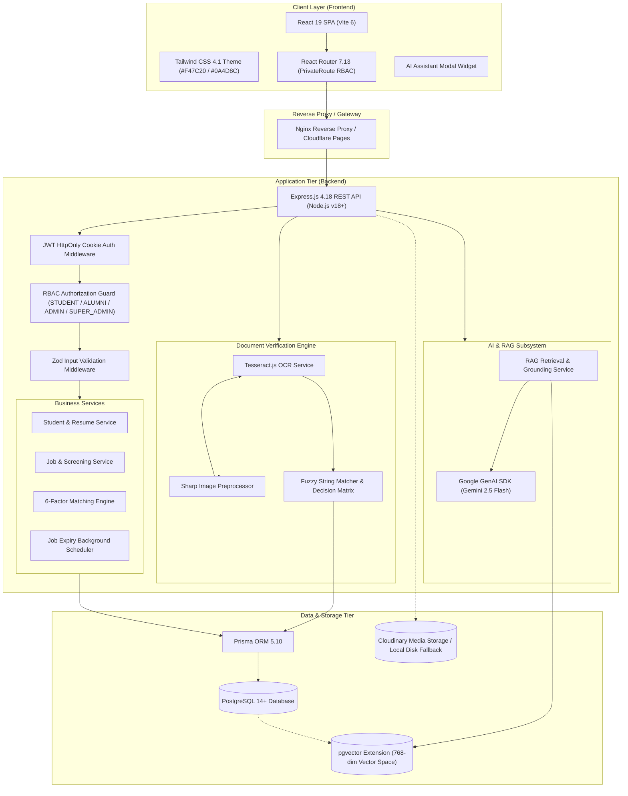
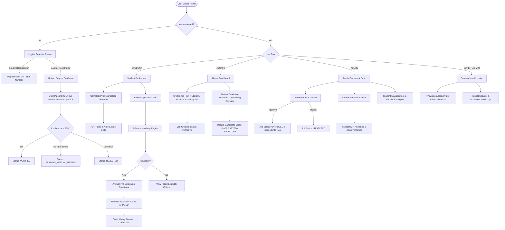
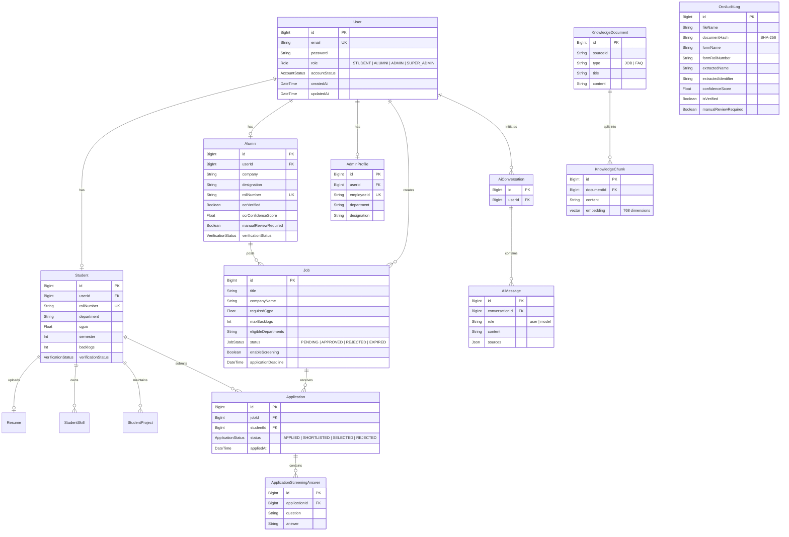
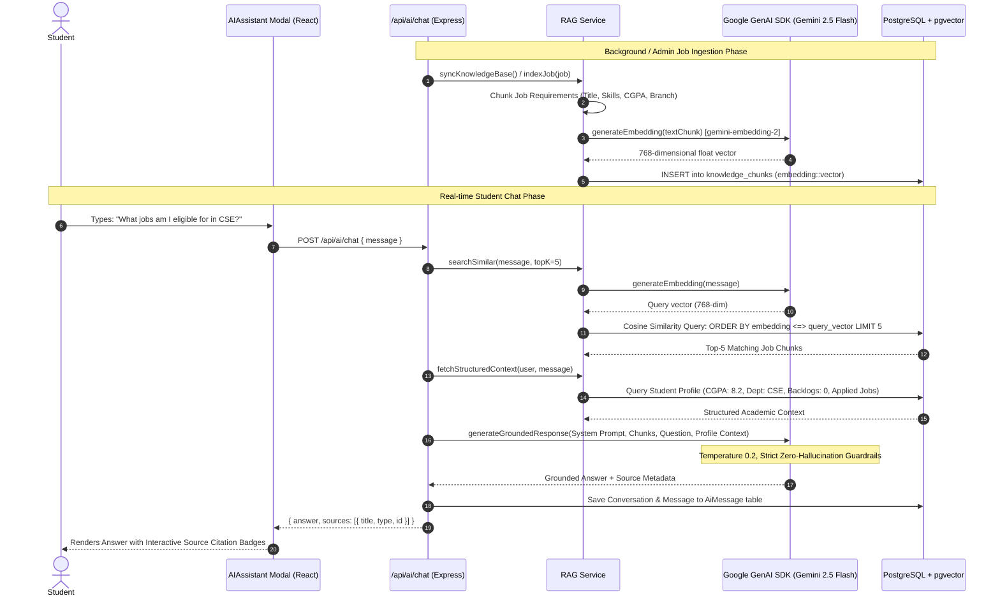
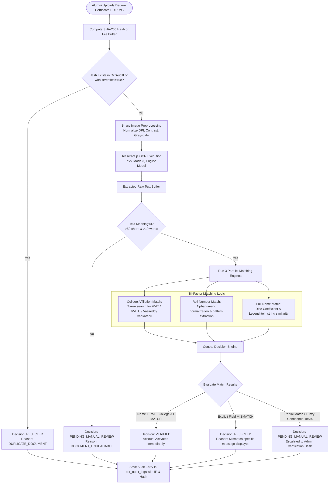
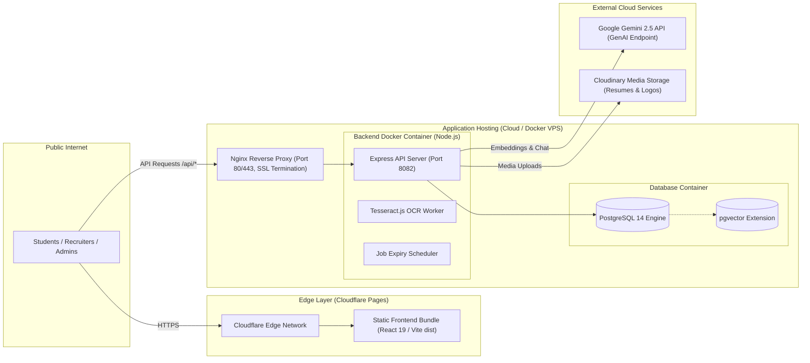

# VVITU Placement Portal: Architecture & Workflow Diagrams

This document contains **verified, production-accurate Mermaid diagrams** representing the actual architecture, workflows, and database entities of the VVITU Placement Portal.

---

## 1. Overall System Architecture

---

## 2. Role-Based Application Workflow

---

## 3. Database Entity Relationship Diagram (ERD)

---

## 4. AI Placement Assistant RAG Pipeline

---

## 5. OCR Degree Document Verification Pipeline

---

## 6. Production Deployment Architecture

